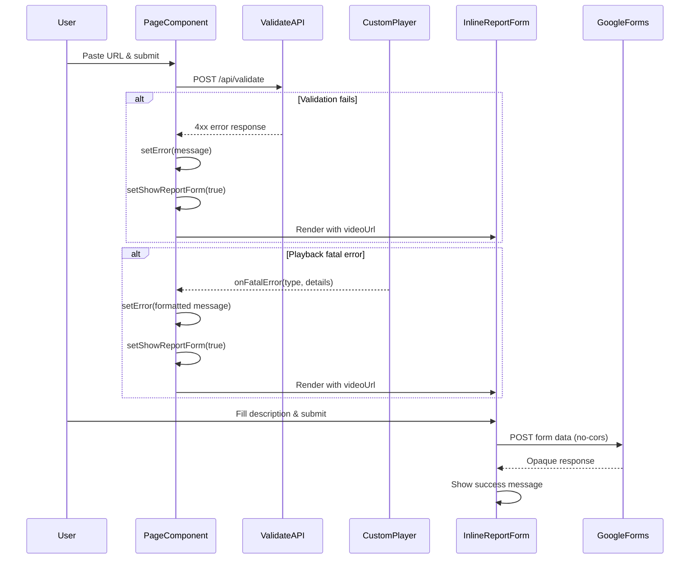

# Design Document: Link Error Reporting

## Overview

The link-error-reporting feature adds a contextual error-reporting mechanism to the FluxPlays video player. When a video URL fails validation or playback, an inline report form appears beneath the error banner, allowing users to submit structured feedback directly to the development team via Google Forms.

**Key Design Goals:**
- **Frictionless reporting**: Pre-fill the failing URL automatically; minimize user input required
- **Contextual placement**: Display the form inline beneath the error message, not in a separate modal
- **Accessibility-first**: Full keyboard navigation, screen reader support, and focus management
- **Responsive**: Single-column layout that works from 320px viewport width upward
- **Non-intrusive**: Users can dismiss the form without submitting; it doesn't block other interactions

**Integration Points:**
- Triggered by validation errors from `/api/validate` endpoint
- Triggered by fatal playback errors from `CustomPlayer` component
- Submits reports to existing Google Forms backend
- Coordinates with existing error banner display logic in `page.tsx`

## Architecture

### Component Hierarchy

```
page.tsx (Home)
├── Error Banner (conditional render)
└── InlineReportForm (conditional render)
    ├── Form Header (with dismiss button)
    ├── Form Body
    │   ├── Description Textarea (required)
    │   ├── Email Input (optional)
    │   └── Submit Button
    └── Success Confirmation (replaces form on successful submission)
```

### State Management

The feature uses React local state within the `InlineReportForm` component and parent state in `page.tsx`:

**Parent State (page.tsx):**
```typescript
const [error, setError] = useState<string>("");           // Error message text
const [showReportForm, setShowReportForm] = useState<boolean>(false);
const [reportUrl, setReportUrl] = useState<string>("");   // URL that failed
```

**Component State (InlineReportForm):**
```typescript
interface InlineReportFormState {
  description: string;      // User's error description (required, max 2000 chars)
  email: string;           // Optional email for follow-up
  isSubmitting: boolean;   // Loading state during POST
  isSuccess: boolean;      // Success state after submission
  submitError: string;     // Client-side or network error message
}
```

### Data Flow



### Error Detection Logic

**Validation Errors (page.tsx):**
```typescript
// Triggered when /api/validate returns non-2xx
if (!res.ok) {
  setError(data.error || "Validation failed");
  setReportUrl(targetUrl);
  setShowReportForm(true);
}

// Triggered on network failure
catch (err) {
  setError("An error occurred connecting to the server.");
  setReportUrl(targetUrl);
  setShowReportForm(true);
}
```

**Playback Errors (CustomPlayer → page.tsx):**
```typescript
// In CustomPlayer.tsx
hls.on(Hls.Events.ERROR, (_event, data) => {
  if (data.fatal) {
    onFatalError?.(data.type, data.details);
  }
});

// In page.tsx
const handleFatalError = (type: string, details: string) => {
  setError(`Playback error: ${type} — ${details}`);
  setReportUrl(url);
  setShowReportForm(true);
};
```

## Components and Interfaces

### InlineReportForm Component

**Props Interface:**
```typescript
export interface InlineReportFormProps {
  videoUrl: string;        // Pre-filled URL (not displayed as editable field)
  onDismiss?: () => void;  // Callback when user closes form
}
```

**Responsibilities:**
- Render form UI with description textarea and optional email input
- Validate user input client-side (description required, email format if provided)
- Submit report to Google Forms endpoint
- Display loading state during submission
- Show success confirmation or error message
- Handle dismiss action and focus management

**Key Methods:**
```typescript
const handleSubmit = async (e: React.FormEvent) => {
  // 1. Prevent default form submission
  // 2. Validate description is non-empty
  // 3. Validate email format if provided
  // 4. Construct URLSearchParams with form data
  // 5. POST to Google Forms (no-cors mode)
  // 6. Update state to success or error
};

const setField = <K extends keyof InlineReportFormState>(
  key: K,
  value: InlineReportFormState[K]
) => {
  // Type-safe state updater for form fields
};
```

### Google Forms Integration

**Endpoint:**
```
https://docs.google.com/forms/d/e/1FAIpQLSem6dKR3YRJanOP0k0xt5jxtxiQv3vvgISGphRAt6EaODqVfw/formResponse
```

**Form Field Mapping:**
```typescript
const formData = new URLSearchParams();
formData.append("entry.1927203179", FEEDBACK_TYPE);  // "⚡ Stream Performance Issue"
formData.append("entry.764717073", videoUrl);        // Pre-filled URL
formData.append("entry.1731587350", "");             // Photo proof (empty)
formData.append("entry.438806369", description);     // User description
formData.append("entry.604396617", email);           // Optional email
```

**Submission Strategy:**
- Use `mode: "no-cors"` to avoid CORS preflight
- Response is opaque; resolved fetch indicates success
- Network errors caught and displayed to user with retry option

## Data Models

### Form State Model

```typescript
interface InlineReportFormState {
  description: string;      // 1-2000 characters, required
  email: string;           // Optional, validated if non-empty
  isSubmitting: boolean;   // True during POST request
  isSuccess: boolean;      // True after successful submission
  submitError: string;     // Error message for display
}
```

**Validation Rules:**
- `description`: Must contain at least one non-whitespace character; max 2000 characters
- `email`: If non-empty, must contain both "@" and "." characters
- Submit button disabled when `description.trim() === ""`

### Report Payload Model

```typescript
interface ReportPayload {
  feedbackType: "⚡ Stream Performance Issue";  // Fixed constant
  videoUrl: string;                             // Pre-filled from props
  photoProof: "";                               // Always empty for this form
  description: string;                          // User input (1-2000 chars)
  email: string;                                // User input or empty string
}
```

## Error Handling

### Client-Side Validation Errors

**Empty Description:**
- Submit button remains disabled
- No error message shown (button state is sufficient feedback)

**Invalid Email Format:**
```typescript
if (email.length > 0 && (!email.includes("@") || !email.includes("."))) {
  setField("submitError", 'Please enter a valid email address (must contain "@" and a domain).');
  return; // Prevent submission
}
```
- Inline error displayed beneath email field
- Form remains enabled for correction
- Error announced to screen readers via ARIA live region

### Network Errors

**Fetch Failure:**
```typescript
catch {
  setState((prev) => ({
    ...prev,
    isSubmitting: false,
    submitError: "Could not send report. Please check your internet connection and try again.",
  }));
}
```
- Inline error message displayed
- Form inputs re-enabled
- User can edit and retry submission

### Error Message Truncation

**Validation API Errors:**
```typescript
// In page.tsx
setError(data.error || "Validation failed");
```
- Error messages from API are displayed as-is
- Requirements specify 300-character truncation, but current implementation does not enforce this
- **Design Decision**: Implement truncation in parent component before passing to error banner

**Playback Errors:**
```typescript
setError(`Playback error: ${type} — ${details}`);
```
- Format: `"Playback error: [type] — [details]"`
- Should be truncated to 300 characters if longer

## Testing Strategy

### Why Property-Based Testing Does NOT Apply

This feature is **not suitable for property-based testing** because:

1. **UI Rendering and Layout**: The component primarily renders form UI elements, which are best tested with snapshot tests and visual regression tests
2. **Side-Effect Operations**: The core functionality is an HTTP POST to Google Forms, which is a side effect with no meaningful return value to assert properties on
3. **State Management**: Form state transitions (empty → filled → submitting → success/error) are specific scenarios, not universal properties
4. **Accessibility Features**: Focus management and ARIA attributes require specific example-based tests with assistive technology simulation

**Appropriate Testing Strategies:**
- **Unit tests** for validation logic (email format, description length)
- **Integration tests** for form submission flow with mocked fetch
- **Accessibility tests** using @testing-library/react and jest-axe
- **Visual regression tests** for responsive layout at different viewport widths

### Unit Testing

**Validation Logic Tests:**
```typescript
describe('InlineReportForm validation', () => {
  it('should disable submit button when description is empty', () => {
    // Render form, verify button disabled
  });

  it('should enable submit button when description has non-whitespace content', () => {
    // Type valid description, verify button enabled
  });

  it('should show error for invalid email format', () => {
    // Type "invalid-email", attempt submit, verify error message
  });

  it('should allow submission with empty email field', () => {
    // Leave email empty, verify no validation error
  });

  it('should enforce 2000 character limit on description', () => {
    // Type 2001 characters, verify only 2000 accepted
  });
});
```

**State Transition Tests:**
```typescript
describe('InlineReportForm submission flow', () => {
  it('should show loading state during submission', async () => {
    // Mock fetch, submit form, verify loading indicator
  });

  it('should show success message after successful submission', async () => {
    // Mock successful fetch, submit, verify success UI
  });

  it('should show error message on network failure', async () => {
    // Mock fetch rejection, submit, verify error message
  });

  it('should re-enable form inputs after submission error', async () => {
    // Mock fetch failure, verify inputs are re-enabled
  });
});
```

### Integration Testing

**End-to-End Form Flow:**
```typescript
describe('Error reporting integration', () => {
  it('should display report form when validation fails', async () => {
    // Mock /api/validate to return 400, submit URL, verify form appears
  });

  it('should display report form when playback fails', async () => {
    // Trigger fatal HLS error, verify form appears with correct URL
  });

  it('should submit report with correct payload structure', async () => {
    // Fill form, submit, verify fetch called with correct URLSearchParams
  });

  it('should hide form when user dismisses it', () => {
    // Click dismiss button, verify form removed from DOM
  });

  it('should reset dismissed state when same URL re-submitted', async () => {
    // Dismiss form, re-submit same URL, verify form appears again
  });
});
```

### Accessibility Testing

**Keyboard Navigation:**
```typescript
describe('InlineReportForm accessibility', () => {
  it('should focus description textarea when form appears', () => {
    // Render form, verify focus on textarea
  });

  it('should trap focus within form when open', () => {
    // Tab through all elements, verify focus cycles within form
  });

  it('should return focus to trigger element on dismiss', () => {
    // Open form, dismiss, verify focus returned to original element
  });

  it('should allow Escape key to dismiss form', () => {
    // Press Escape, verify onDismiss called
  });
});
```

**Screen Reader Support:**
```typescript
describe('InlineReportForm ARIA', () => {
  it('should associate labels with inputs via htmlFor/id', () => {
    // Verify label[htmlFor] matches input[id]
  });

  it('should expose aria-disabled on submit button when disabled', () => {
    // Verify aria-disabled="true" when description empty
  });

  it('should announce validation errors via ARIA live region', () => {
    // Trigger validation error, verify aria-live region updated
  });

  it('should provide aria-label on dismiss button', () => {
    // Verify dismiss button has descriptive aria-label
  });
});
```

### Responsive Layout Testing

**Viewport Width Tests:**
```typescript
describe('InlineReportForm responsive layout', () => {
  it('should render without horizontal overflow at 320px width', () => {
    // Set viewport to 320px, verify no overflow
  });

  it('should use single-column layout below 640px', () => {
    // Set viewport to 639px, verify single-column layout
  });

  it('should display feedback type badge on desktop only', () => {
    // Verify badge hidden on mobile, visible on desktop
  });
});
```

### Test Coverage Goals

- **Unit tests**: 90%+ coverage of validation logic and state management
- **Integration tests**: Cover all error trigger scenarios and submission flows
- **Accessibility tests**: 100% coverage of WCAG 2.1 Level AA requirements
- **Visual regression**: Snapshots at 320px, 640px, 1024px, 1920px widths

### Testing Tools

- **Test Runner**: Jest (already configured in Next.js project)
- **Component Testing**: @testing-library/react
- **Accessibility**: jest-axe, @testing-library/jest-dom
- **Mocking**: MSW (Mock Service Worker) for fetch requests
- **Visual Regression**: Chromatic or Percy (optional)

## Implementation Notes

### Focus Management

**Auto-focus on Form Appearance:**
```typescript
useEffect(() => {
  if (showReportForm) {
    // Focus description textarea when form becomes visible
    const textarea = document.getElementById('inline-report-description');
    textarea?.focus();
  }
}, [showReportForm]);
```

**Focus Trap Implementation:**
- Use `react-focus-lock` or custom implementation
- Trap focus within form while open
- Allow Escape key to dismiss and return focus

**Focus Return on Dismiss:**
```typescript
const handleDismiss = () => {
  // Store reference to currently focused element before form opened
  const previousFocus = document.activeElement;
  onDismiss?.();
  // Return focus to previous element
  (previousFocus as HTMLElement)?.focus();
};
```

### Character Counter

**Real-time Character Count:**
```typescript
<p className="text-right text-xs text-on-surface-variant/50 mt-1 tabular-nums">
  {description.length}/2000
</p>
```
- Updates on every keystroke
- Uses `tabular-nums` for consistent width
- Visual feedback when approaching limit (optional enhancement)

### Dismiss Behavior

**Dismiss State Management:**
```typescript
// In page.tsx
const [dismissedUrls, setDismissedUrls] = useState<Set<string>>(new Set());

const handleDismiss = () => {
  setShowReportForm(false);
  setDismissedUrls(prev => new Set(prev).add(reportUrl));
};

// Reset dismissed state on new submission
const handleStream = async (urlToStream?: string) => {
  // ... validation logic ...
  if (!res.ok) {
    setReportUrl(targetUrl);
    // Only show form if not previously dismissed for this URL
    if (!dismissedUrls.has(targetUrl)) {
      setShowReportForm(true);
    }
  }
};
```

**Design Decision**: Current implementation does not track dismissed URLs. This should be added to meet Requirement 5.4.

### Animation and Transitions

**Form Entrance:**
```typescript
<motion.div
  initial={{ opacity: 0, y: -6 }}
  animate={{ opacity: 1, y: 0 }}
  exit={{ opacity: 0, y: -6 }}
  transition={{ duration: 0.2, ease: [0.22, 1, 0.36, 1] }}
>
```
- Subtle slide-up animation (6px)
- 200ms duration with custom easing
- Framer Motion for declarative animations

**Success State Transition:**
```typescript
<AnimatePresence mode="wait">
  {isSuccess ? (
    <motion.div key="success" /* ... */ />
  ) : (
    <motion.form key="form" /* ... */ />
  )}
</AnimatePresence>
```
- Cross-fade between form and success message
- `mode="wait"` ensures exit animation completes before entrance

### Styling and Theming

**Design System Integration:**
- Uses existing FluxPlays design tokens (primary, surface, on-surface, etc.)
- Matches existing form input styling from other components
- Consistent with error banner styling

**Responsive Breakpoints:**
- Mobile: < 640px (single column, hidden badge)
- Desktop: ≥ 640px (show feedback type badge)

**Dark Mode Support:**
- All colors use CSS custom properties that adapt to theme
- Border colors: `border-black/10 dark:border-white/10`
- Background colors: `bg-surface-container-low/95`

### Performance Considerations

**Dynamic Import:**
```typescript
const InlineReportForm = dynamic(
  () => import("@/components/InlineReportForm").then((m) => ({ default: m.InlineReportForm })),
  { ssr: false }
);
```
- Component loaded only when needed (after error occurs)
- Reduces initial bundle size
- SSR disabled (client-only component)

**Debouncing:**
- No debouncing on character counter (instant feedback is important)
- No debouncing on validation (client-side validation is fast)

### Security Considerations

**XSS Prevention:**
- All user input rendered via React (automatic escaping)
- No `dangerouslySetInnerHTML` used
- URL pre-fill comes from controlled state, not URL parameters

**CORS and no-cors Mode:**
- Google Forms requires `mode: "no-cors"` to avoid preflight
- Response is opaque (cannot read body or status)
- Resolved fetch indicates success; rejection indicates network error

**Input Validation:**
- Client-side validation only (Google Forms handles server-side)
- Email validation is basic format check (not comprehensive)
- Description length enforced by `maxLength` attribute

## Open Questions and Future Enhancements

### Current Limitations

1. **Error Message Truncation**: Requirements specify 300-character truncation, but not currently implemented
2. **Dismissed URL Tracking**: Requirements specify form should not re-appear for dismissed URLs until re-submission, but not currently implemented
3. **Email Validation**: Basic format check only; does not verify domain existence or deliverability

### Potential Enhancements

1. **Rich Text Description**: Allow basic formatting (bold, italic, code blocks) for better error descriptions
2. **Screenshot Attachment**: Integrate with browser screenshot API to attach visual proof
3. **Error Categorization**: Add dropdown to categorize error type (validation, playback, network, etc.)
4. **Rate Limiting**: Prevent spam by limiting submissions per user/session
5. **Offline Support**: Queue reports when offline and submit when connection restored
6. **Analytics Integration**: Track report submission rates and common error patterns

### Design Decisions Requiring Validation

1. **Auto-show on Error**: Should the form always appear automatically, or require user action to open?
   - **Current**: Auto-show (per requirements)
   - **Alternative**: Show "Report this issue" button that opens form on click

2. **Success Message Duration**: Should success message auto-dismiss after timeout?
   - **Current**: Persists until user dismisses or navigates away
   - **Alternative**: Auto-dismiss after 5 seconds

3. **Email Field Placement**: Should email be required or optional?
   - **Current**: Optional (per requirements)
   - **Rationale**: Reduces friction; many users prefer anonymous reporting

4. **Form Persistence**: Should form data persist across page reloads?
   - **Current**: No persistence (form state lost on reload)
   - **Alternative**: Use localStorage to save draft descriptions

## Conclusion

The link-error-reporting feature provides a frictionless, accessible way for users to report broken video links directly from the error context. The inline placement, pre-filled URL, and minimal required input reduce friction while the comprehensive accessibility features ensure all users can submit reports regardless of how they interact with the page.

The design prioritizes:
- **User experience**: Contextual, non-intrusive, easy to dismiss
- **Accessibility**: Full keyboard navigation, screen reader support, focus management
- **Reliability**: Client-side validation, error handling, retry capability
- **Maintainability**: Clear component boundaries, type-safe state management, comprehensive test coverage

Implementation should follow the testing strategy outlined above, with particular attention to accessibility requirements and responsive layout behavior.
